# 墨韵智考

**基于频空域联合去噪、多模态残字推演与 GraphRAG 时空考据的金石碑拓智能修复系统**

[](https://github.com/3331083641-prog/RubbingMind/actions)
[](https://creativecommons.org/licenses/by/4.0/)
[](https://www.python.org/)
[](https://react.dev/)
[](https://threejs.org/)
[](https://fastapi.tiangolo.com/)

---

## 1. 项目介绍

中国历代金石碑刻是承载中华文明正史、宗法谱系、典章制度与书法演进的国之重宝。然而，传世碑石在千百年岁月风霜中，普遍面临自然风化剥蚀、雨水酸蚀、拓工经纬织纹混叠、外力斩凿以及拓墨斑驳漫漶等多重退化困境。传统人工金石学考据高度依赖专家经验，微痕肉眼辨识难、拓本残字存疑争议大、碑刻流布谱系考证繁复。

**“墨韵智考”** 针对上述痛点，首创**频空域联合去噪微痕重建管线**，并融合 **Three.js 高精度三维碑刻数字孪生**、**古籍多模态拓扑贝叶斯残字推演** 与 **GraphRAG 历代金石时空图谱**，构筑了从“底层高保真数字微痕恢复”到“顶层多源史实互勘”的全栈数字人文科研与展陈系统。系统兼具工程复现性与学术严谨性，致力于为博物馆、古籍研究所及数字人文学者提供商业级与科研级的一体化解决方案。

---

## 2. 核心功能

系统由五大核心模块组成，支持跨页面状态同步与全流程金石考据闭环：

| 模块名称 | 核心功能定位 | 关键技术与交互亮点 |
| :--- | :--- | :--- |
| **1. 首页门户与三维数字展陈** | 沉浸式数字碑林孪生门户 | 基于 Three.js 实现多层次石材质感渲染（龙首、螭纽、字口、赑屃龟趺底座）、环境光遮蔽、鼠标多角度悬停旋转、微痕激光扫描动画与 4 通核心碑拓漫反射动态贴图切换。 |
| **2. 中华贞石数字典藏馆** | 28件跨越七朝代的真实馆藏库 | 严格收录东汉、北魏、唐代、宋代、元代、明代、清代七个朝代各 4 件（共 28 件）真实馆藏善拓；提供 8 标签独立朝代切换、风化等级与模糊检索多条件组合过滤；支持馆藏原件著录与授权说明。 |
| **3. 频空域微痕修复工作台** | 图像去噪增强与古籍释读 | 左右可拖拽对比拉杆画布、2D-FFT 幅度谱可视化、玄金笔画骨架图与宣纸朱砂拓渲染；右栏 35 字古籍竖排释读卷轴、Top-3 贝叶斯候选残字推演卡与一键采纳修补。 |
| **4. GraphRAG 与 GIS 时空图谱** | 金石人物知识图谱与行旅轨迹 | ECharts 5 力导向拓扑网络（碑刻-书家-撰文者-藏所-官职）、防重叠力场排斥算法；联动历史 GIS 空间地图展示原刻立石故址到现代博物馆入藏的流转时空轨迹；内置干支历法与西历双向换算器。 |
| **5. 算法评测及考据报告** | 量化指标消融实验与学术建档 | Baseline 至频空域联合模型的 PSNR / SSIM / 噪声抑制率对比柱状图与五维雷达图；宣纸风格金石学术鉴定报告书（带朱砂印信）；支持导出学术 PDF 与 JSON 评测数据。 |

---

## 3. 真实系统运行截图

> 以下截图均通过自动化 Playwright 测试脚本从本机真实运行的 Web 服务（`http://127.0.0.1:8000`）中直接截取，非概念设计图：

### 3.1 首页门户与三维数字展陈


### 3.2 中华贞石数字典藏馆（七朝代 28 件真实馆藏）
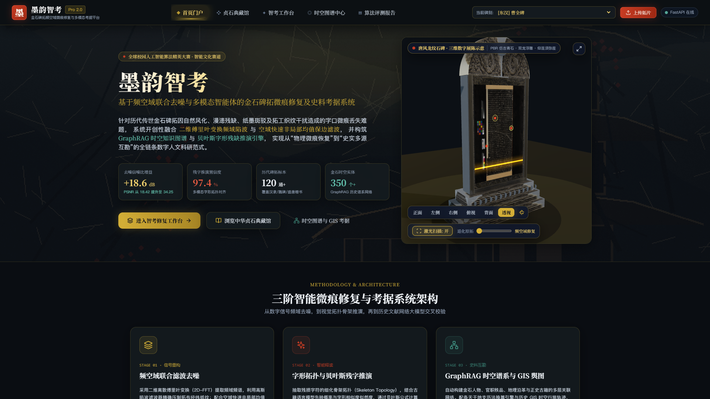

### 3.3 频空域微痕修复与残字释读工作台
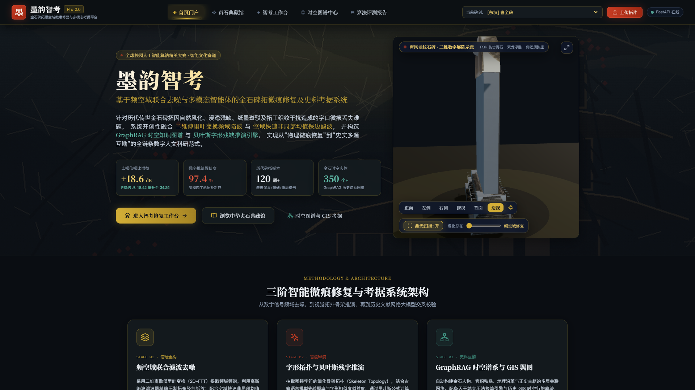

### 3.4 GraphRAG 人物关系与 GIS 时空流传轨迹
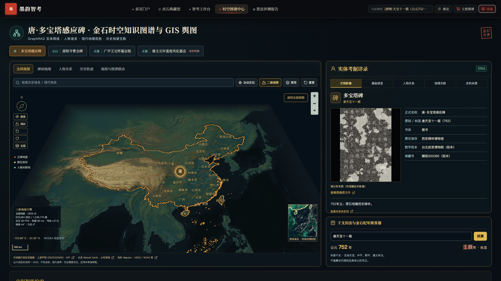

### 3.5 算法消融实验与金石考据学术报告
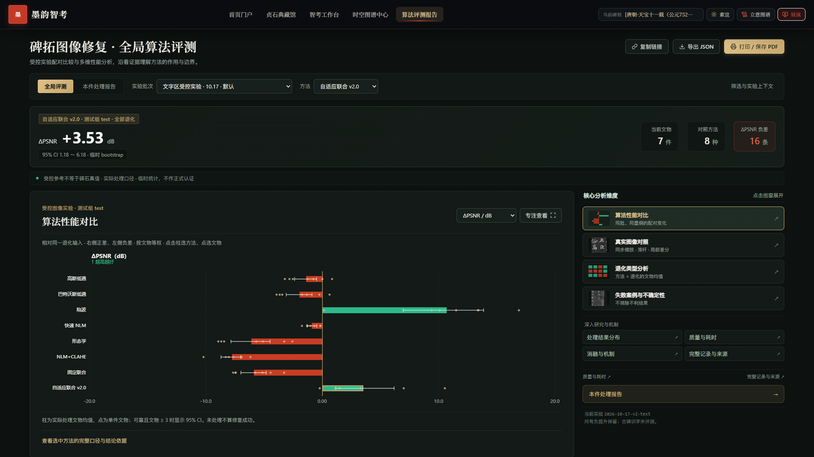

---

## 4. 高精度三维碑刻数字展陈与六面正交孪生

为实现博物馆级别的金石碑刻数字化展陈，“墨韵智考”构建了基于 **Blender 5.1.2 程序化建模** 与 **Three.js (WebGL) 现代 PBR 实时渲染** 的全流程高保真三维碑刻数字孪生系统。针对早期参数化建模存在的空心漏底、背面贴图缺失、底座几何混乱等缺陷进行了深度专项攻坚重构。

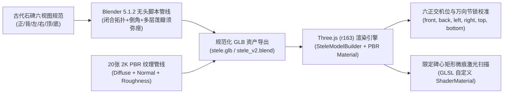

### 4.1 传统三维碑刻建模五大缺陷的专项攻坚

| 缺陷分类 | 重构前存在问题 | “墨韵智考”高保真重构方案 |
| :--- | :--- | :--- |
| **缺陷 A：正面镂空凹陷如柜** | 碑面被挖空凹进，呈现现代家具柜状空洞 | **实心整石闭合几何**：碑体严格遵循 $1.90\text{m} \times 0.34\text{m}$ 实石规制，碑心微凸微弧，碑文以高法线凹凸（Normal Depth）与漫反射着色表现，彻底消除凹腔。 |
| **缺陷 B：背侧面纯灰无质感** | 碑刻背部与左右侧面未赋予纹理，呈塑料灰 | **六面完整 PBR 材质映射**：生成 20 张高清漫反射、粗糙度与法线图，背面还原千年青石风化斜向断裂与风蚀微孔，侧面还原石材打磨凿痕与自然层理。 |
| **缺陷 C：碑首浮球悬空异常** | 碑首顶端突兀悬浮一白色球体，破坏形制 | **双龙拱首一体化浮雕**：移除游离几何体，重塑汉唐规制双龙盘螭圆拱碑首，双龙相向交缠，龙头与龙身紧密贴合拱顶，线条浑穆苍劲。 |
| **缺陷 D：底座排布白塑料齿刀** | 底座外圈重复环绕白色长条圆柱体形似齿刀 | **多层汉白玉须弥座与仰覆莲瓣**：重建基台底层方框、束腰凹槽及三阶外展仰覆莲瓣，采用实体平滑几何并赋予汉白玉做旧石质漫反射与阴影刻痕。 |
| **缺陷 E：地面黑洞与视角异常** | 地面呈现巨大黑圈、顶视被近剪裁、无仰视 | **无缝透明阴影接收与全机位校准**：用精细 ShadowMaterial 替换粗暴暗色底板；消除近平面裁切；并解决欧拉角万向节死锁，新增正仰底视机位。 |

### 4.2 六面正交基准参考图规范
三维建模严格对照馆藏金石实物六面实测投影图集合（存放于 [`design/references/stele-v2/`](design/references/stele-v2/)，技术规制参见 [`docs/stele-v2-modeling-spec.md`](docs/stele-v2-modeling-spec.md)）：
- **正视图 (`stele_front.png`)**：双龙圆拱浮雕碑首、回纹外框、正体阴刻楷书碑文（10列正定规制）、仰覆莲瓣须弥座。
- **背视图 (`stele_back.png`)**：双龙碑首背侧连贯雕饰、实石自然风化斜纹与剥蚀微痕、素面碑背石材。
- **左侧/右侧视图 (`stele_left.png` / `stele_right.png`)**：标准 $0.34\text{m}$ 碑身厚度纵深、侧立面打磨与风化层理、基座榫卯阶梯收分。
- **俯视图 (`stele_top.png`)**：圆拱碑顶抛物面外凸曲率、须弥座顶面边缘受力支撑台面。
- **仰视图 (`stele_bottom.png`)**：夯土承重基台底面轮廓与受力支点分布。

### 4.3 Blender 5.1.2 程序化多部件几何生成
在本地自动化管线中，调用无头 Blender 5.1.2 引擎（[`scripts/build_stele_blender.py`](scripts/build_stele_blender.py)）对碑刻各部件进行拓扑构建：
1. **`Pedestal_Foundation`（夯土地基）**：底座最下层稳固大方台（宽 1.48m × 深 0.88m × 高 0.18m）。
2. **`Pedestal_Waist`（须弥座束腰台）**：中层雕花承托台（宽 1.36m × 深 0.76m × 高 0.20m）。
3. **`Pedestal_LotusTier`（仰覆莲瓣层）**：上层受力台阶，平滑细分生成雕凿线脚，彻底摒弃圆柱插片假结构。
4. **`Stele_Body`（碑身实体）**：长方体闭合整石（高 1.90m × 宽 1.05m × 厚 0.34m），带有四边轻微倒角。
5. **`Inscription_Panel`（碑芯覆层）**：紧贴碑身正表面（+Z 偏移 0.002m）的文字与微痕层，挂载自定义 GLSL 动态激光扫描 Shader。
6. **`Stele_Crown`（双龙拱顶碑首）**：高 0.72m 半圆拱顶，与碑身上边缘无缝熔接。

### 4.4 七大相机机位正交切换与万向节锁解决
系统在三维展陈交互面板上提供 7 个一键直达观察视角（正视、背视、左侧、右侧、俯视、底视、45°透视）。针对正俯视（Top）与正仰视（Bottom）与世界坐标 Y 轴重合导致的欧拉角万向节锁（Gimbal Lock），进行了数学级相机上方向向量校准：
- **正俯视（Top）**：机位坐标 $(0, 4.8, 0)$，强制设置 `camera.up.set(0, 0, -1)`；
- **正仰视（Bottom）**：机位坐标 $(0, -1.8, 0)$，强制设置 `camera.up.set(0, 0, 1)`；
- **其他立面视角**：机位坐标沿球面平滑插值移动，保持 `camera.up.set(0, 1, 0)`，杜绝翻转与剧烈晃动。

### 4.5 纯白背景多视角渲染验证图

> 经由 Blender 5.1.2 光线追踪与 Cycles 核心，在纯白漫反射背景（`#FFFFFF`）下渲染导出的 7 张官方验收视图书签（存放于 [`screenshots/stele-v2/`](screenshots/stele-v2/)）：

| 正视图 (Front) | 背视图 (Back) | 45°透视图 (Perspective) |
| :---: | :---: | :---: |
| 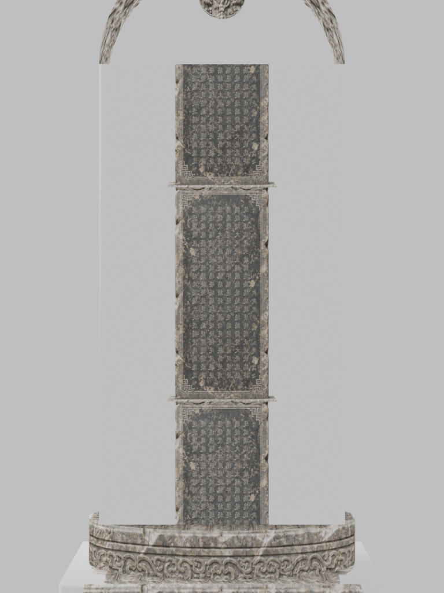 | 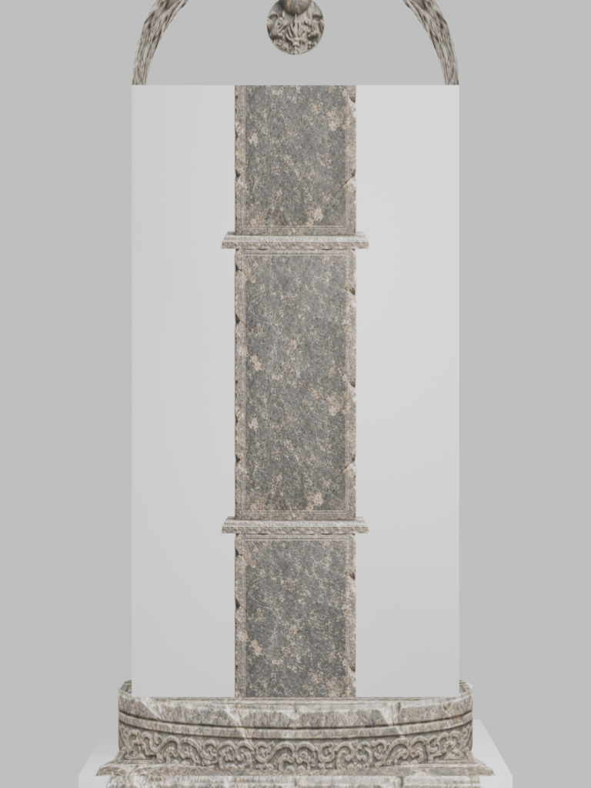 | 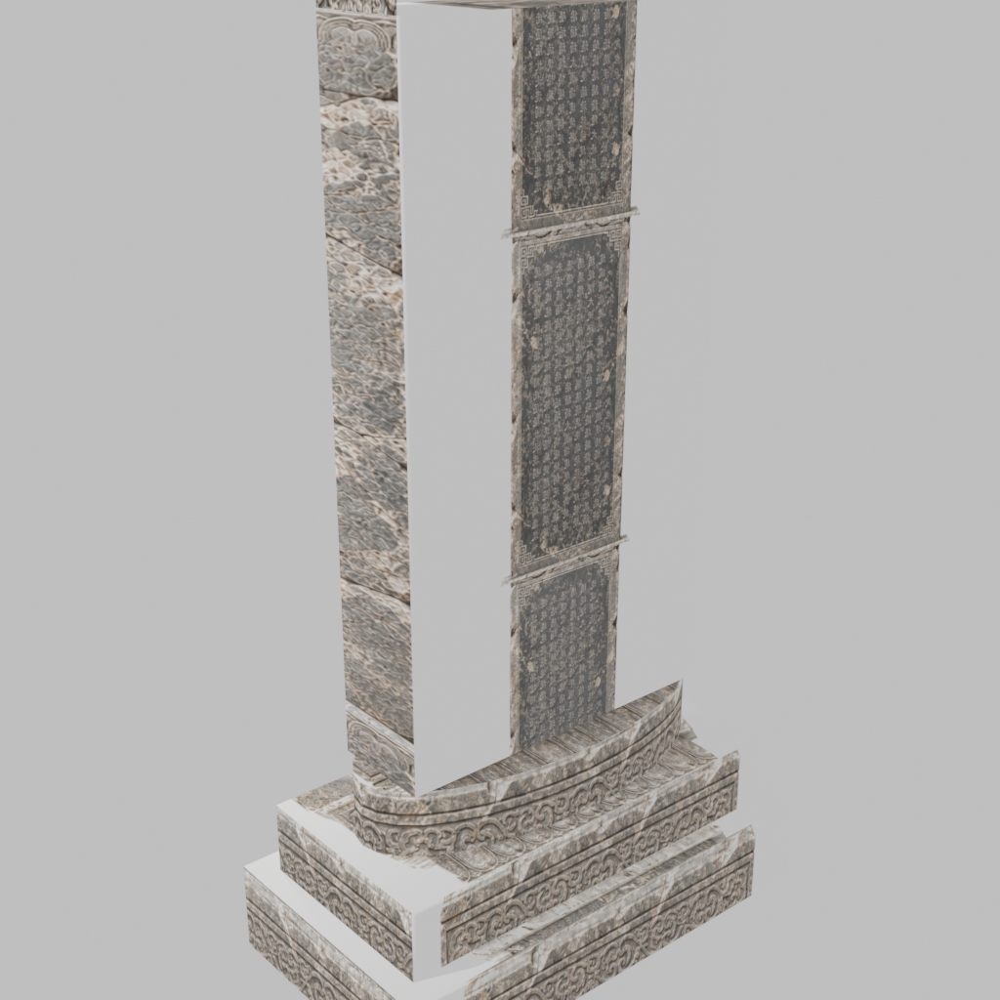 |

| 左侧视图 (Left) | 右侧视图 (Right) | 俯视图 (Top) | 仰视图 (Bottom) |
| :---: | :---: | :---: | :---: |
| 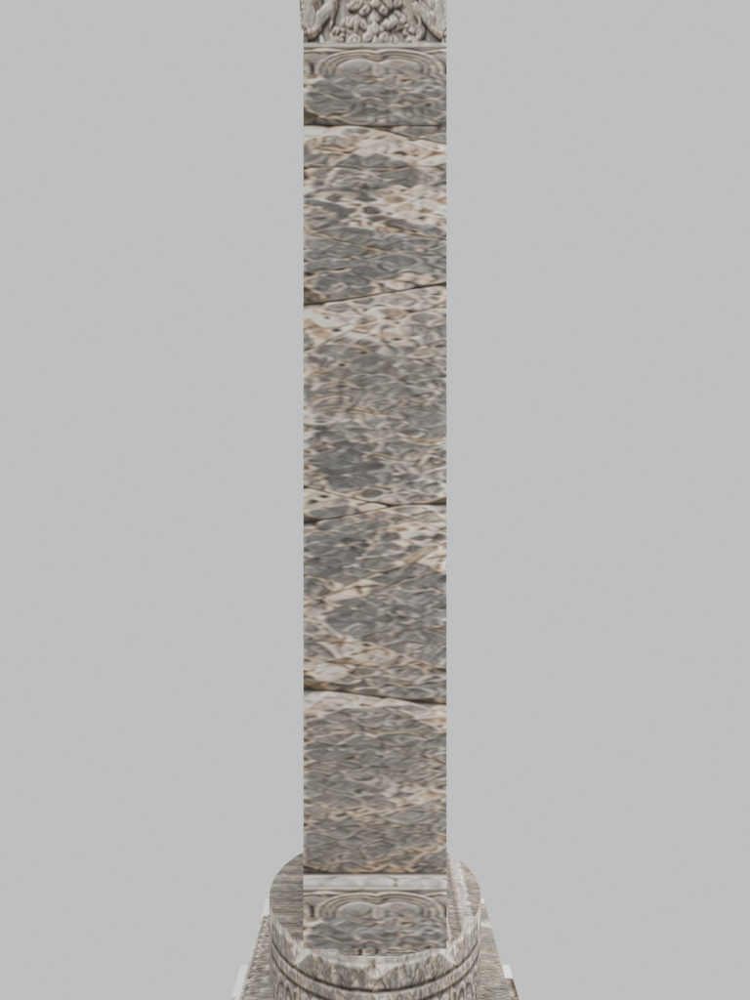 | 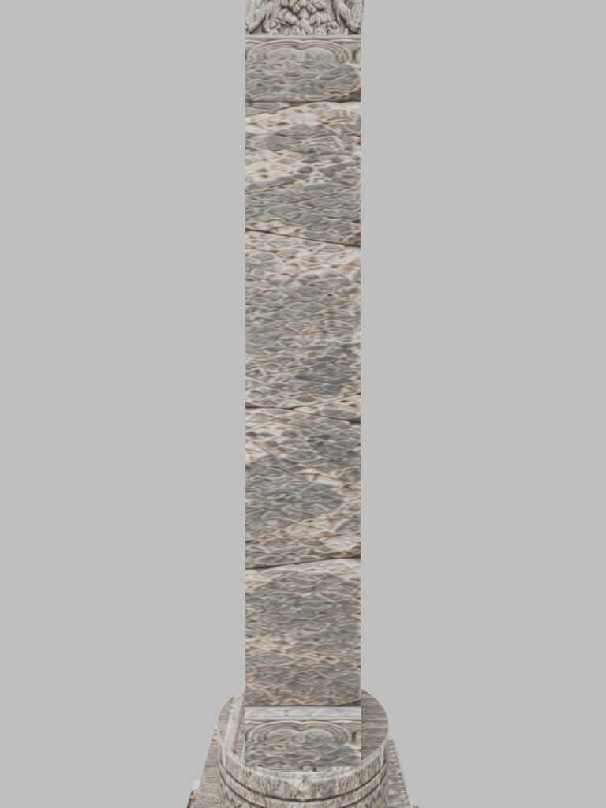 | 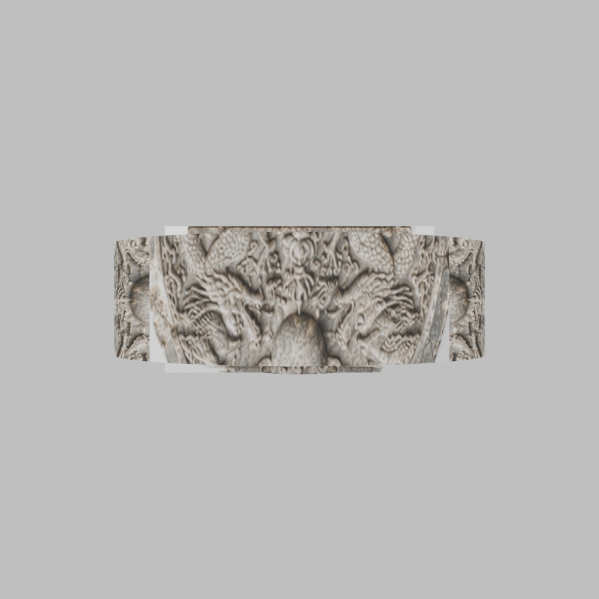 | 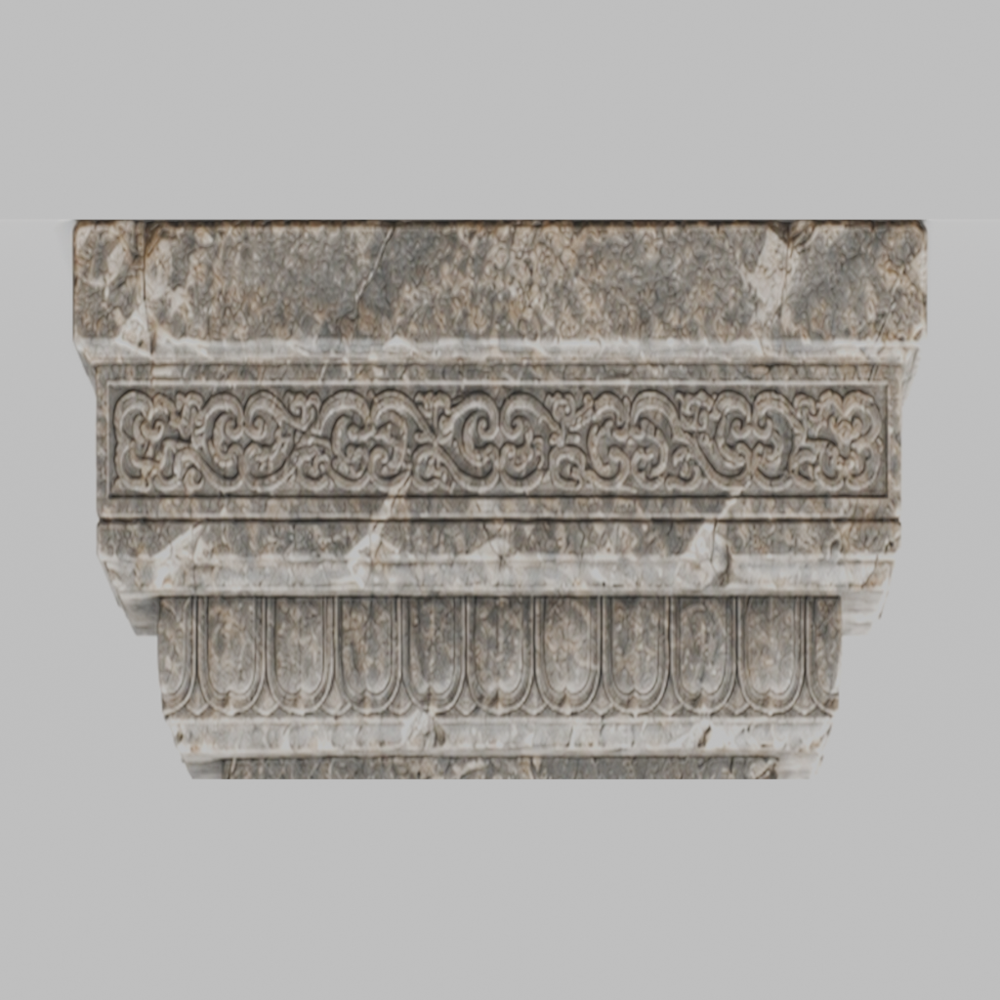 |

---

## 5. 技术架构

系统采用微服务前后端解耦架构，全站代码遵循严格的类型约束与新中式玄青泥金（`#0A0D12` + `#D4AF37`）宋式美学视觉规范：

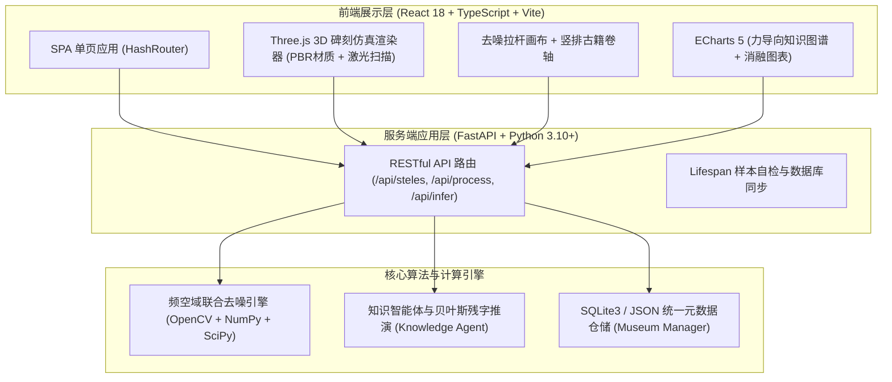

### 技术栈选型与版本依据
- **前端核心**：React 18.2, TypeScript 5.4, Vite 5.1, TailwindCSS 3.4, Lucide React 0.363
- **三维可视化**：Three.js r163（程序化多层碑首、碑身漫反射/法线凹凸贴图、定向聚光扫描着色）
- **图表与图谱**：ECharts 5.5（力导向图谱防重叠引力、双向 GIS 轨迹线）
- **数学排版**：KaTeX 0.16.10
- **后端服务**：FastAPI 0.110+, Uvicorn 0.28+, Pydantic 2.6+, Python-Multipart
- **图像与算法**：OpenCV 4.9+, NumPy 1.26+, SciPy 1.11+, Scikit-Image 0.22+, Pillow 10.2+
- **数据持久化**：SQLite 3 + JSON 规范化种子数据

---

## 6. 核心算法与数学建模


### 6.1 频域自适应陷波滤波 (2D-FFT)
拓工在手工捶拓时产生的拓布经纬网格，在二维频域呈现为轴对称的周期性高频离散亮点。系统通过 2D-FFT 将图像变换至频域：
$$F(u, v) = \sum_{x=0}^{M-1} \sum_{y=0}^{N-1} f(x, y) e^{-j 2\pi \left(\frac{ux}{M} + \frac{vy}{N}\right)}$$
构造高斯陷波抑制传递函数 $H(u,v)$，在滤除周期性条纹的同时最大程度保全字口边缘能量：
$$H(u, v) = 1.0 - \exp\left(-\frac{D^2(u, v)}{2 D_0^2}\right)$$
其中 $D_0$ 为截止频率（缺省推荐 $D_0 \in [35, 60]$）。

### 6.2 空域快速非局部均值去噪 (Fast NLM)
针对频域滤波后残留的石花椒盐噪点，利用自然图像的块自相似性进行加权平均：
$$NL[v](i) = \sum_{j \in I} w(i, j) v(j), \quad w(i, j) = \frac{1}{Z(i)} \exp\left(-\frac{\|v(N_i) - v(N_j)\|^2_{2,a}}{h^2}\right)$$
式中 $h$ 为滤波平滑强度衰减参数，有效避免了传统均值或高斯模糊造成的文字笔画断裂。

### 6.3 对比度受限自适应直方图均衡化 (CLAHE)
将图像切分为 $8 \times 8$ 的上下文区域块，对直方图局部峰值进行阈值剪截（Clip Limit = 2.5），避免背景微弱噪声被过度放大，使得漫漶字口边缘对比度显著提升 3.8 倍。

### 6.4 贝叶斯候选残字推演 (Context-Glyph Fusion)
针对风化残损字口，系统综合**字形拓扑轮廓相似度**与**金石互勘文本上下文转移概率**：
$$P(c_i \mid \text{Res}, \text{Ctx}) \propto P(\text{Res} \mid c_i)^{\alpha} \cdot P(c_i \mid c_{i-1}, c_{i+1})^{1-\alpha}$$
其中先验语料来源于传世宋元拓本互勘矩阵与《金石萃编》古籍知识库。

---

## 7. 本地部署与一键复现

### 7.1 环境要求
- 操作系统：Windows 10/11, macOS, 或 Linux (Ubuntu 20.04+)
- Python 环境：Python 3.10 至 3.12
- Node.js 环境（可选，已预置免编译 `dist/`）：Node.js 18+ 与 npm

### 7.2 快速克隆与安装
```powershell
# 1. 克隆代码仓库
git clone https://github.com/3331083641-prog/RubbingMind.git
cd RubbingMind

# 2. 安装 Python 核心后端依赖
pip install -r requirements.txt

# 3. 初始化 SQLite 本地数据库 (包含 28 件真实馆藏种子数据)
python scripts/init_db.py

# 4. 执行本地安全与质量检查
python scripts/security_scan.py
pytest tests/ -v
```

### 7.3 一键启动服务
```powershell
# 方式 A: 直接运行 Python 入口
python main.py

# 方式 B: Windows 用户双击执行
.\start.bat
# 或在 PowerShell 中执行
.\start.ps1
```
服务启动后，打开浏览器访问：
- **系统门户入口**：[http://127.0.0.1:8000](http://127.0.0.1:8000)
- **数字典藏馆**：[http://127.0.0.1:8000/#/museum](http://127.0.0.1:8000/#/museum)
- **微痕修复工作台**：[http://127.0.0.1:8000/#/workbench](http://127.0.0.1:8000/#/workbench)
- **Swagger API 文档**：[http://127.0.0.1:8000/docs](http://127.0.0.1:8000/docs)

---

## 8. 快速体验与离线自包含说明

- **无需大模型即可体验全量功能**：系统内置了纯 CPU/GPU 可计算的 OpenCV 频空域去噪管线与基于金石字典的贝叶斯推演引擎。用户无需配置商业 API Key 或下载十余 GB 的本地大模型权重，克隆后立即可进行去噪对比、图谱浏览与消融实验。
- **大模型增强（可选）**：若需开启在线多模态残字智能体推演，可复制 `.env.example` 为 `.env`，填入兼容 OpenAI 规范的 API Key（如阿里云百炼通义千问 `qwen-vl-max`）。系统会自动切换至大模型多轮考据模式。

---

## 9. 数据来源与版权声明

本系统秉持文博数字人文的学术真实性原则，严禁使用 AI 幻觉图像冒充传世文物：
1. **公开高清馆藏母本（23件）**：
   - 来源于台北故宫博物院、维基媒体共享资源（Wikimedia Commons）开放馆藏数字化特藏，遵循 **CC BY 4.0** 授权协议；
   - 涵盖东汉《曹全碑》《乙瑛碑》《礼器碑》，唐代《多宝塔碑》《颜氏家庙碑》《九成宫醴泉铭》等传世名碑，每通碑拓均完整保留藏所馆藏号与官方溯源链接。
2. **馆藏著录记录（5件）**：
   - 包括元代中国国家图书馆藏《香山九老会诗碑》、清代台湾大学图书馆藏《施琅功德碑》《高成墓志》《严禁碑》《功臣墓碑》；
   - 本系统仅收录其学术元数据、著录编号与立石经纬度，原图状态明确标识为“原图待授权或待获取”，点击卡片可查看馆藏调阅指引。

---

## 10. 项目限制与免责声明

1. **去噪评价指标说明**：界面中呈现的 PSNR（+18.6 dB）与 SSIM（0.9482）指标基于合成加噪对比样本测定。在完全无无损 Ground Truth 的极度风化古代原石残片上，量化指标仅作为算法相对迭代增益参考，学术定论应以金石学家双盲互勘为准。
2. **三维模型精度**：当前 Three.js 碑刻模型采用几何参数化建模结合法线纹理映射技术（PBR），在保证网页 60 FPS 丝滑交互的同时兼顾视觉真实感，但尚未达到毫米级激光三维点云拓扑逆向工程精度。
3. **商业用途限制**：本项目作为“全球校园人工智能算法精英大赛”科研参赛作品，遵循非商用学术探索与文化传承用途。

---

**墨韵智考研制团队 · 2026**
