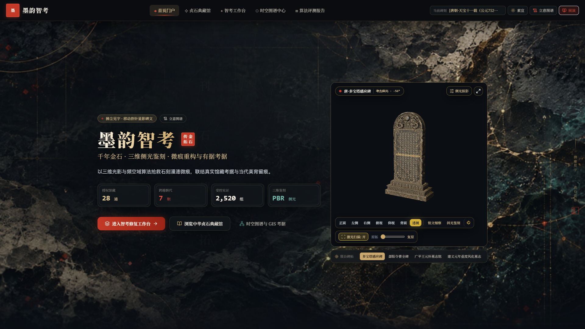
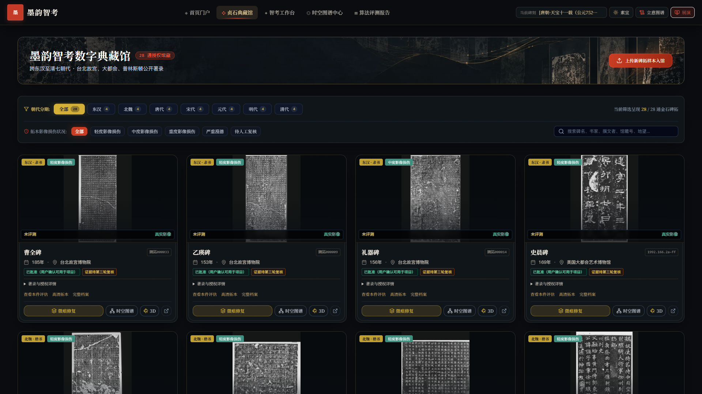
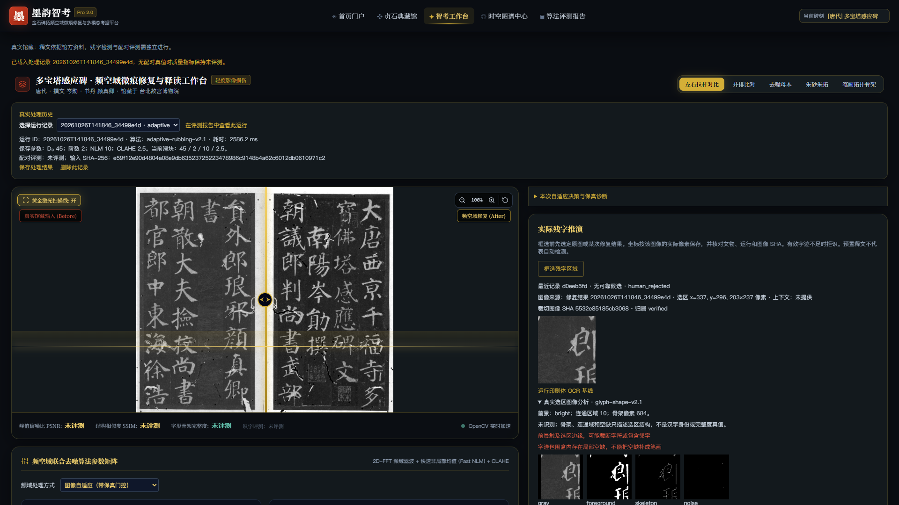
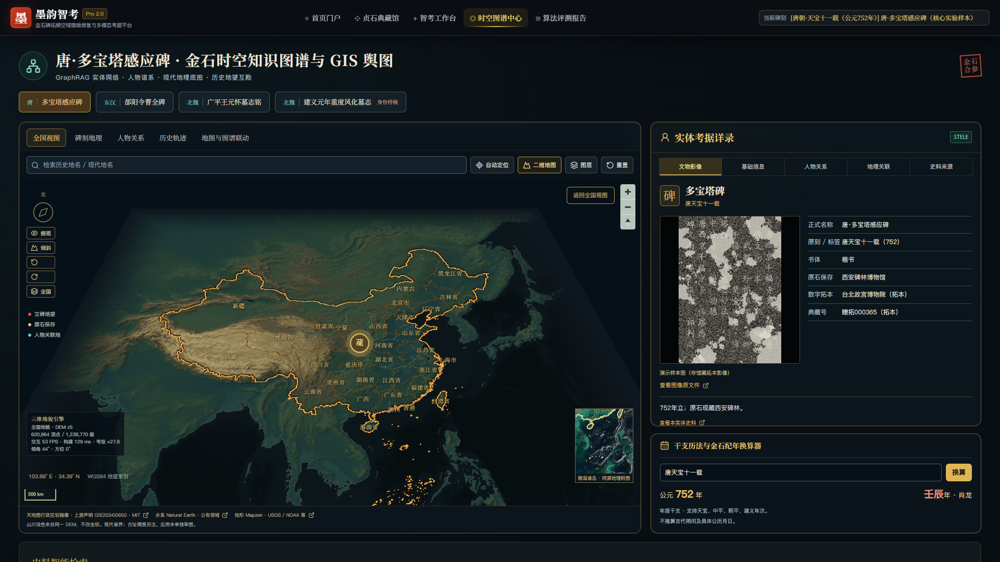
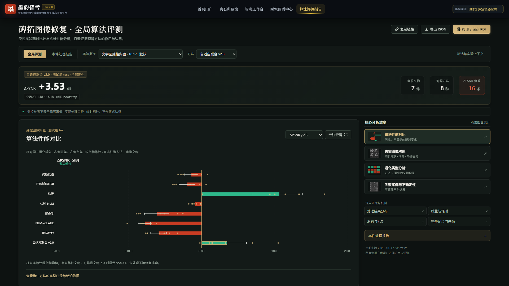

# 墨韵智考 RubbingMind

> **以当代数字媒体，守望千年贞石微痕。**  
> 面向“石刻文物风化不可逆”与“古碑公众阅读门槛高”双重时代痛点，融汇 **Blender 5.2.2 三维金石重建**、**2D-FFT 频空域自适应微痕复原**、**真实 DEM 三维时空舆图**、**有据史料检索（SQLite FTS5/BM25）** 与 **当代美育留痕工坊** 的全栈数字媒体与数字人文平台。

---

## 数字媒体升级与策展亮点（华灿奖创意赛道 · 数字媒体方向）

### 1. 东方金石当代美学设计系统
- **语义化双主题一键切换**：默认**「玄石暗馆（Obsidian Stele）」**（深炭墨与古青石底色、宿宣米白主文、朱砂印红与泥金/石青克制点缀），一键切换**「素宣书斋（Xuan Paper）」**（旧宣纸暖白底色、徽墨主文、1px 古籍界栏线）。
- **材质与排印反差**：全局叠加零交互阻挡的 SVG 宣纸/石刻微颗粒质感层；标题与碑文采用中文衬线体（Noto Serif SC），算法参数与置信度采用等宽制表数字，结合竖排题跋与朱/白文篆刻微件，兼容 `prefers-reduced-motion`。
- **16:9 纯净展演模式 & 作品立意图谱**：顶部一键开启「展演模式」（隐藏非必要调试条，适配 1080P 录屏与展板截图，底部浮动章节导览，按 `Esc` 退出）及「立意图谱」策展白皮书弹窗。

### 2. Blender 5.2.2 + WebGL 真实三维金石质感升维
- **可复现无头建模流水线**：[tools/blender/build_exhibition_stele.py](tools/blender/build_exhibition_stele.py) 通过本地 Blender 5.2.2 LTS 无头脚本程序化构建闭合流形风化倒角碑身、螭首拱额与黑曜泥金展台，并基于真实碑拓烘焙阴刻法线/粗糙度/AO 贴图，导出仅 **3.82 MB** 的轻量化 [huacan-exhibition-stele.glb](apps/web/public/assets/stele/model3d/gallery/huacan-exhibition-stele.glb)（14,720 顶点 / 29,036 面），同时完整保留既有唐风双龙碑原件 `stele-final.glb` 支持一键切换对比。
- **考古侧光掠影（Raking Light）与运镜预设**：实时拖动虚拟侧光方位角（`-78° ~ +78°`）与掠射仰角（`8° ~ 64°`），一键切换**考古斜射光 / 冷月光 / 暖烛火 / 展馆柔光**色温，并支持**全景瞻仰 / 铭文细察 / 斜光鉴刻**平滑运镜及六向正交机位。

### 3. 四重沉浸式策展动线（观碑 · 复原 · 释读 · 留痕）
- **沉浸序章「拂尘见字 / 数字传拓」**：首页全屏光墨交互画布，移动指针如执墨扑与侧光掠过碑面，古老碑文与朱砂印记缓缓显影；首屏即可切换多通精选碑拓投影至三维展台。
- **观碑与复原可视化**：工作台提供 **2.6× 光学局部放大镜**、**3D 侧光联动**、**卷轴帘幕分屏滑块**、**诗意四阶处理反馈（拂尘去噪 → 寻脉识字 → 推演残笔 → 考据释义）**及**残损关注区叠层**；若本地后端未启动，自动无缝回退至带「典藏演示态」朱印微标的本地前端演练预览。
- **人文深度释读 & AI 金石学伴**：原碑文 / 白话译注双栏对照、点击单字联动竖排古籍卷轴、书体笔法与字形演变微赏；「AI 金石学伴」优先调用本地 `/api/research/query` 实证检索，并严格分层展示**【馆藏史料考据】**与**【AI 导览推演】**边界。
- **文化留痕工坊（高清 PNG 导出）**：摘选当前碑刻名句或单字，实时高分辨率排版生成**数字碑帖藏品卡 / 竖排宣纸书签 / 当代极简文化海报**，支持自定义落款题记与朱/白文印章样式，一键导出无水印高清 PNG。

### Blender 5.2.2 3D 资产本地复现命令

```powershell
# 需本地安装 Blender 5.2.2 LTS（示例路径 D:\Codex\blender-5.2.2\blender-5.2.2-windows-x64\blender.exe）
D:\Codex\blender-5.2.2\blender-5.2.2-windows-x64\blender.exe --background --python tools/blender/build_exhibition_stele.py
# 输出：apps/web/public/assets/stele/model3d/gallery/huacan-exhibition-stele.glb (~3.82 MB)
# 及元数据：apps/web/public/assets/stele/model3d/gallery/exhibition-stele-meta.json
```

---

## 五个核心页面

| 页面 | 实际功能 |
|---|---|
| 首页门户 | 「拂尘见字」交互显影序章、原有循环视频、Blender 5.2.2 侧光三维碑刻展台（双模型切换）、四重策展动线与精选碑林样本 |
| 贞石典藏馆 | 七朝代各 4 件，共 28 件正式馆藏；真实封面 / 阅读图 / 档案图、搜索筛选、来源许可、复核状态和三维侧光展陈 |
| 智考工作台 | PNG / JPEG / WebP 上传、频空域自适应处理、局部放大镜与 3D 联动、真实运行历史、残字选区与人工采纳/驳回、双栏译注与 AI 金石学伴、文化留痕高清 PNG 导出 |
| 时空图谱中心 | Three.js + MapLibre + 真实 DEM，国界 / 省界独立图层、地形贴地标记、史料关系、纪年换算和有来源的全文检索 |
| 算法评测报告 | 批次总览和本件运行报告，实际实验筛选、PSNR / SSIM / 边缘 F1、方法图表、同步图像对照、失败与负提升、机制证据、JSON / PDF 导出 |

前四页截图来自 2026-10-26 的本地实际运行；报告页截图来自 2026-10-27 的视觉重构验收。完整的 1920×1080、1440×900、1366×768 证据和核验记录位于 [screenshots/sync-verification](screenshots/sync-verification/)。

### 首页门户



### 贞石典藏馆



### 智考工作台



### 时空图谱中心



### 算法评测报告



[真实图像对照](screenshots/report-redesign/final/images-expanded.png) · [退化热力图](screenshots/report-redesign/final/heatmap-expanded.png) · [失败案例](screenshots/report-redesign/final/failure-case-expanded.png) · [机制步骤](screenshots/report-redesign/final/mechanism-flow-expanded.png) · [真实交互录屏](screenshots/report-redesign/final/interaction-demo.webm)

报告采用大型分析舞台与证据图窗：切换单一评价指标，点击方法与退化联动，支持专注查看、ESC 恢复及减少动态效果。新增热力图、处理状态分布与同批历史质量／耗时图；图表、JSON 和 PDF 附表来自同一计算层。正差不等于修复成功，原图返回单列。设计审查与实际 Skills 使用见 [report-redesign](docs/report-redesign/IMPLEMENTATION_REPORT.md)。

## 馆藏、史料与图像来源

正式目录为 [data/catalog/steles28.json](data/catalog/steles28.json)，东汉、北魏、唐、宋、元、明、清各 4 件。28 件作品使用 84 张独立的封面、阅读与档案影像，保留馆藏机构、典藏号、原刻年代、拓本年代、来源 URL、逐件许可与署名。来源包括台北故宫博物院、美国大都会艺术博物馆和普林斯顿大学艺术博物馆。许可按现有记录为 23 件 CC BY 4.0、2 件 CC0、3 件 Public Domain；数字图像许可与文物本身的年代或权属分开判断。

逐件来源和许可见 [馆藏影像说明](docs/museum-image-sources.md)，入库过程见 [第三轮馆藏集成](docs/museum-v3-integration.md)。正式影像保持原哈希；原始下载归档、重复高清成品和本机私人图片不整体上传。

[data/catalog/claims](data/catalog/claims/) 保存逐件主张、四级证据、引用和未解决冲突。原刻载体、拓本、藏所、作者 / 书丹者 / 刻工 / 碑主分别记录；争议不按来源排序自动选边，待人工复核的内容不会升级为核定事实。四件核心样本使用独立身份，合成测试文本和未确认文物身份有明确提示，不能当作真实释文或评测真值。用户上传也不自动进入 28 件正式目录。

史料检索使用本地 SQLite FTS5 / BM25、实体识别和有来源的一跳关系扩展。答案来自现有证据摘录；资料不足、实体不明确或来源有冲突时保留拒答 / 不确定性，不调用语言模型补写未知历史。

## 实际算法与评测范围

工作台默认使用输入图像驱动的自适应处理：分析频谱、噪点、残差和字口风险，选择陷波、孤立噪点处理、NLM 或保留原图，并记录保真门控与原因。固定高斯 / Butterworth、形态学、NLM、CLAHE 及联合流程保留作对照。无合格频率峰时的陷波分支直接返回像素相同的副本，避免无效 FFT 往返造成截断改动。

每次处理记录独立运行 ID、参数、输入 / 输出 SHA、工作副本尺寸、随机种子和时间。原图返回、实际改动、无法判定分别展示；输出与输入相同不算实际修复提升。真实历史拓本没有配对真值时，PSNR / SSIM 显示未评测。

受控实验数据位于 [experiments](experiments/)。两个主要批次使用不同采样协议，合计 28 件作品、280 个退化输入、9 种方法、2520 条输出记录。报告直接读取登记结果、图像和来源哈希，展示方法比较、按文物分组的统计、同步参考 / 输入 / 输出、差分、失败记录和负提升。局限与不利结果一并保留，不跨采样协议把均值差称为算法迭代提升。

本轮审计重算 2520 条保存记录的 PSNR / SSIM / 边缘 F1，与保存值一致；按固定哈希规则为每件作品、每种方法选取一条，252 次历史源码快照重放的输出像素均一致。详见 [实验核验记录](docs/sync-audit/EXPERIMENT_EVIDENCE.json)。这项核验不重现机器耗时，也不证明无参考古碑修复质量或识字准确率。

需要保留的研究边界：

- `heldout-v20-v21-2026-10-18` 是保留的历史 ID；实际页面标为同批复测，不能称为独立留出验证。该批没有保存图像，只能展示数值。
- 旧 2026-10-15 joint 使用生成器退化标签选陷波，存在先验泄漏，仅保留为历史记录；当前生产决策不接收退化标签或参考图。
- 机制 PNG 和重放链绑定历史提交 `7623a52`，不宣称已经按当前交付 HEAD 全量重算。
- 部分历史 CI 派生文件的来源哈希已过期，服务端明确拒绝。前端临时 bootstrap 会标注来源、种子与限制，不伪称后端已核验统计。
- A24 专指候选 / 人工采纳字形的导出标签 schema 尚未实现；选区局部处理到报告的完整跨页闭环也仍待独立开发。已有人工操作记录不等于独立标注集；古碑残字 Top-1 / Top-3 为未评测。

## 三维地图架构

V2.2 使用真实 DEM、Three.js `BufferGeometry` 与 MapLibre 共用相机和投影。高程来自 AWS Open Data Terrain Tiles / Mapzen Terrarium，仓库内保留 z0–z6 概览瓦片；更高层级按需获取，不进入普通 Git。

国界由 34 个省级面拓扑并集生成，省际共享边界独立去重。国界、省界和水系采样同一 DEM 贴地绘制；标记按地形投影，地名做屏幕空间避让，边界可独立开关。垂直夸张只改变显示，不改高程或经纬度。二维 / 三维共享数据；无 WebGL 时按既有路径回退。

当前底图表达现代行政边界；古址地望按各条证据保留精度，不把区域性地点画成精确墓址。上游数据声明不等于本应用已取得独立审图许可，本应用仍未单独审图。技术和来源见 [引擎架构](docs/terrain3d/ARCHITECTURE.md)、[数据来源](docs/terrain3d/DATA_SOURCES.md)、[V2.2 说明](docs/terrain3d/V22_VISUAL_REFINEMENT.md) 和 [史料图谱审查](docs/graph-history-audit.md)。性能依设备、画幅和浏览器而变。

## 安装与运行

建议 Python 3.10–3.12、Node.js 20+。CI 使用 Python 3.11 和 Node.js 20。Windows PowerShell 5.1 / 7 均可使用启动脚本。

```powershell
python -m venv .venv
.\.venv\Scripts\Activate.ps1
pip install -r requirements.txt
python scripts/init_db.py
cd apps/web
npm ci
npm run build
cd ../..
.\start.ps1
```

`init_db.py` 初始化本地 SQLite，并按正式目录迁移馆藏镜像；迁移会备份原资料，保留用户记录。`start.ps1` 使用脚本所在目录、按需构建前端并记录本项目 PID。查看它输出的实际端口，执行 `.\check.ps1` 自检和 `.\stop.ps1` 停止它启动的服务。旧 `/static/index.html` 书签跳转当前前端入口。

也可分开启动开发服务，按后端 health → generate → 前端的顺序检查：

```powershell
# 终端一，仓库根目录
python -m uvicorn main:app --host 127.0.0.1 --port 8000

# 终端二
Invoke-RestMethod http://127.0.0.1:8000/health
Invoke-RestMethod http://127.0.0.1:8000/generate
cd apps/web
$env:RUBBINGMIND_API_TARGET='http://127.0.0.1:8000'
npm run dev
```

前端代理目标必须与当前后端一致；独立 worktree 或测试实例应显式设置 `RUBBINGMIND_API_TARGET`。本地 API 文档为 `/docs`。

## 私有数据与可选模型

可用环境变量 `RUBBINGMIND_DB_PATH`、`RUBBINGMIND_RUNTIME_DIR`、`RUBBINGMIND_UPLOAD_DIR`、`RUBBINGMIND_RESULTS_DIR` 将数据库、用户图像、审核记录和处理结果独立存放；权威馆藏与实验数据不随这些变量改变。对应目录、`.env`、密钥、node_modules、虚拟环境和缓存不提交。

残字推演能生成实际选区的前景、噪点、连通区域和骨架，并检索用户人工确认的本地参考字形。可选视觉模型通过 `RUBBINGMIND_VISION_API_KEY`、`RUBBINGMIND_VISION_BASE_URL`、`RUBBINGMIND_VISION_MODEL` 在后端配置。只有配置兼容的视觉服务后才可调用；调用可能收费，外部服务的古碑识字效果不包含在本次验收中。未配置或不可用时如实显示有限的模板 / 上下文建议或无候选。

默认服务绑定 loopback。远程模式 `RUBBINGMIND_DEPLOYMENT=remote` 对私有数据和写接口要求 `RUBBINGMIND_ADMIN_TOKEN` 管理员 Bearer 认证，未配置则拒绝；远程模式不公开 OpenAPI 页面。该模式仍是单管理员工具，不提供多租户隔离、完整账号体系或公网配额管理。

## 验证与复现

```powershell
python -m pytest tests -q
python scripts/validate_museum_v3.py
python scripts/validate_history_gis.py
python scripts/security_scan.py
python scripts/verify_experiment_evidence.py
# 另外按每件作品 / 每种方法固定取一条历史代码重放；使用你选定的临时目录
python scripts/verify_experiment_evidence.py --replay --temp-root D:\Codex\temp
cd apps/web
npm ci
npm run build
npm run test:url
npm run test:studio
npm audit
```

浏览器专项需要已经运行的独立测试后端 / 前端。使用显式测试端口（例如 8740 / 5740），先把四个私有状态环境变量指向测试目录，避免写入个人运行数据；浏览器脚本会拒绝部分用户默认端口。

```powershell
$env:GRAPH_BACKEND_URL='http://127.0.0.1:8740'
$env:GRAPH_FRONTEND_URL='http://127.0.0.1:5740'
$env:RUBBINGMIND_FRONTEND_URL='http://127.0.0.1:5740'
python scripts/test_terrain3d_v22_browser.py
python scripts/ci_browser_smoke.py
python scripts/test_technical_v2_browser.py --ci --url http://127.0.0.1:5740
python scripts/verify_sync_delivery.py --backend http://127.0.0.1:8740 --url http://127.0.0.1:5740
```

本机严格视频播放检查可设置 `RUBBINGMIND_BROWSER_CHANNEL=msedge`。开放源码 Chromium 未必有 H.264 解码器；CI 的媒体专项同时检查海报回退，不把回退误报为真实播放。

本轮审计、差异和取舍见 [docs/sync-audit](docs/sync-audit/)。2026-10-25 的 [product-upgrade 文档](docs/product-upgrade/) 作为开发与审查历史保留，尚未关闭的学术 / 产品待办没有被同步操作自动标为完成。