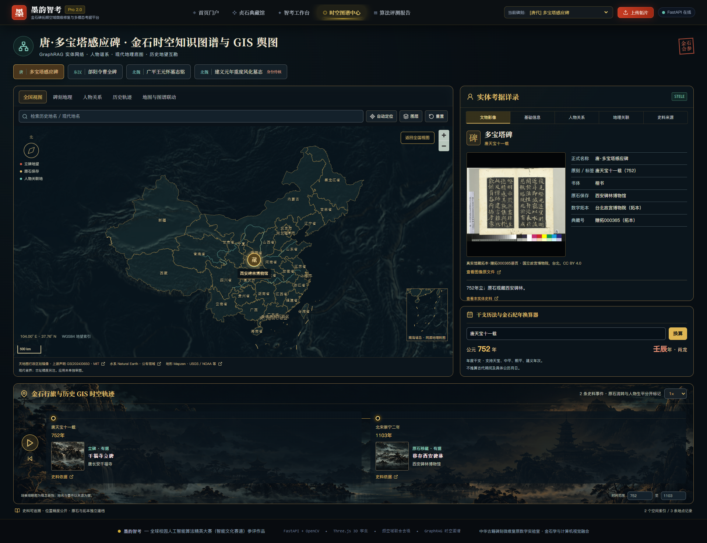
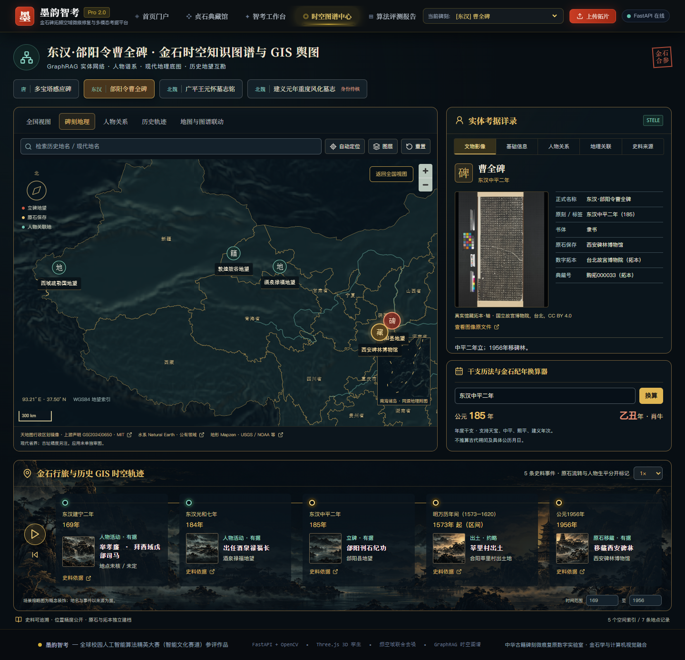
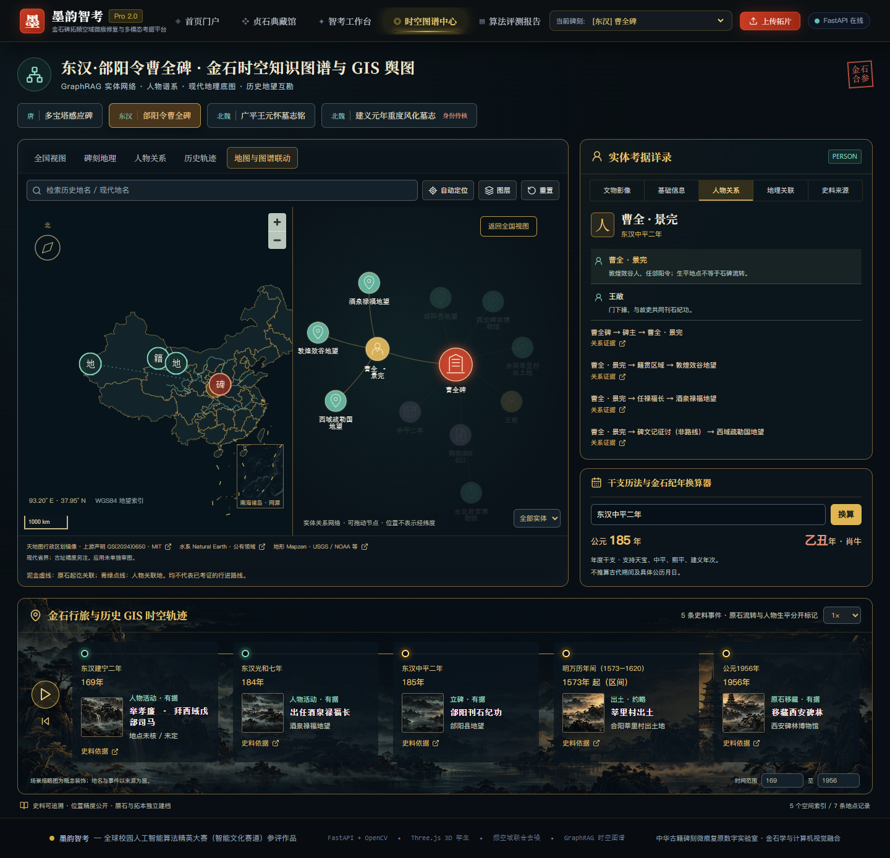

# 墨韵智考时空图谱升级交付记录

开发与史料检索：2026-10-14；最终浏览器与视觉修正：2026-10-15。项目：D:\RubbingMind。

## 已实现

MapLibre全国地理地图、同源南海附图、真实地形阴影与黄河/长江中心线；全国复位、滚轮、平移、双击、搜索、图层开关与自动定位。ECharts知识网络支持实体筛选、类别图形、点击、拖动和缩放。四碑沿用App选中ID，联动右侧档案、年号及不同事件时间轴。时间轴提供暂停、速度、重播、事件定位与结束停止；图谱与地图共用实体/地点ID。

## 四碑规模与身份

| 核心入口 | 地点记录 | 可绘空间索引 | 图谱节点 | 关系 | 时间轴记录 |
|---|---:|---:|---:|---:|---:|
| tang-duobao | 3 | 2 | 9 | 8 | 2条有据事件 |
| han-caoquan | 7 | 5 | 12 | 11 | 4条有据事件，1条约略出土区间 |
| wei-yuanhuai | 2 | 1 | 7 | 6 | 2条文献支持事件 |
| wei-jianyi | 0 | 0 | 3 | 2 | 1条未核样本标签，0条已确认历史事件 |

第四入口保留为“北魏碑拓数字化退化测试样本”。本地合成文字与王诵馆藏资料不一致；无法证明同一性，不冒用王诵、韩夫人、藏号或迁移路线。元怀独立图谱纠正了误映射吴高黎，但本地图像、出土村址及原石馆藏仍待核。

## 地图与史料来源

- 行政边界：[天地图数据的固定版本镜像](https://github.com/MisterChangRay/geodeparse/tree/dfb4ce2c1f7f48a5da5ad7842cbfbe1b2cd29757/geo)，34省级面与8界线，原件SHA-256及许可记录见资源provenance.json。包含大陆、东北、西北、西南、台湾、海南、港澳及南海诸岛/界线，南海附图采用同源真实坐标。
- 水系：[Natural Earth公有领域数据](https://www.naturalearthdata.com/about/terms-of-use/)。地形：[Mapzen Terrain Tiles](https://registry.opendata.aws/terrain-tiles/)，0–3级原始Terrarium瓦片，完整提供者署名随资源保存。
- 数据库存WGS84，经度在前；行政面原件为CGCS2000，在公里级区域索引精度下采用零参数近似，再由MapLibre投影至Web Mercator。没有GCJ-02、人工常数偏移或测量级转换声明。
- 史料以西安碑林、故宫及台北故宫馆藏条目、刘军论文为据。多宝塔752年立/1103年移藏、曹全185年立/1956年移藏分别核验。来源表、具体坐标、空坐标和分歧见[历史审计](graph-history-audit.md)。

千福寺、莘里村、元怀墓葬、台北拓本馆址未录入未经核实GPS。西安、合阳、敦煌、酒泉、疏勒和洛阳是行政面内部区域索引，非古址精确定位；碑林用实地摄影地理标记作馆区近似。没有测量误差资料，不填写虚构精度数值。

**公开地图许可与审图仍有验收边界。** 官方地图下载入口在本次检索中连接失败；镜像的MIT许可及上游GS(2024)0650声明已保留，但不能据此宣称上游授权已重新核准，或本应用已取得公开地图审图批准。界面明确标注这一点。史料不足部分不以补造内容完成验收。

## 验证结果

- 后端完整pytest：49项通过（包含新增图谱、身份、关联、地理包含性、年号与异常输入测试）。
- 前端：TypeScript检查和Vite生产构建通过。现有大包体积提示仍存在；地图/网络懒加载，地图对象复用，监听与Canvas卸载清理已检查。
- 真实浏览器：Playwright + Edge，1920×1080、1440×900、1366×768逐碑切换通过，补充390宽捕获无横向溢出。新增实际网络Canvas点击、拖动与滚轮缩放测试；地图搜索、定位、播放、暂停、重播及复位通过；关键浏览器错误为0。
- 纪年：752壬辰、185乙丑、517丁酉、528戊申；未知年号、超范围年次、非法中文数字及朝代/年号不匹配拒绝转换；不生成具体朔闰月日。
- 视觉：按参考图检查，7项具体修正已完成；复核ship只覆盖这些修正，不是地图合规认证或所有史料身份认证。
- 修改范围：只涉及图谱实现、图谱API/纪年、最小App选择适配、专用资源、测试和文档。未更改首页/三维模型、典藏馆UI与28件封面、修复算法、工作台、评测及报告实现。此前碑模提交和无关未跟踪文件保留。

提交前发现同目录另一馆藏任务并发修改共享文件，最终交付改为在D:\Codex\worktrees\RubbingMind-gis-final隔离工作目录中组装；再次通过49项后端测试、TypeScript、生产构建、坐标检查、安全扫描及完整Playwright验收。独立验证端口为后端8001、前端5174，测试脚本支持环境变量切换端口。仅本次150项清单进入提交，另一任务的工作文件保留在原目录。

## 实际运行截图与全部文件

[完整文件清单](graph-files.txt)逐条列出代码、数据、资源和截图（含85个地形瓦片）。截图来自真实运行网页，位于screenshots/graph-final；browser-results.json保存检查结果。

## GitHub同步

只提交本次清单中的必要文件，正常推送现有main分支，不重写历史。提交后的GitHub Actions须依据该提交SHA单独确认，不能以此前碑模CI或本地构建结果替代。
